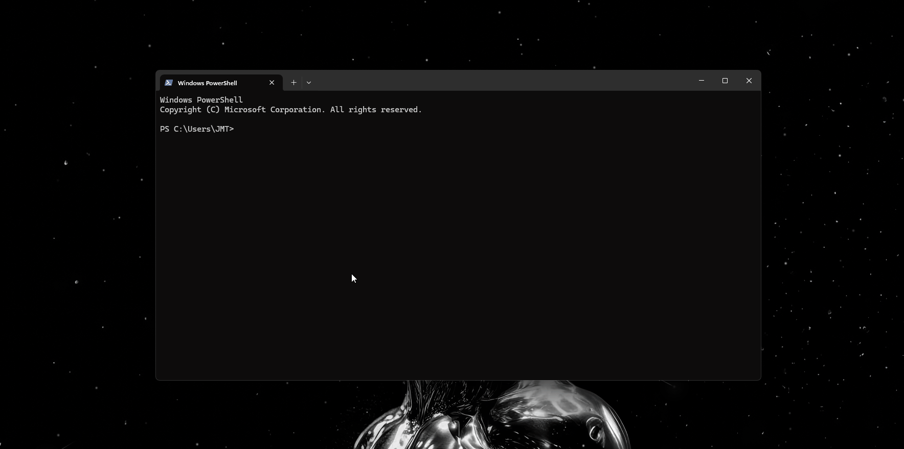

# Gitviz


Gitviz is a small terminal tool for poking around any public GitHub repository without cloning it. You can browse the files, read the commit history, check the repo's stats and see who has contributed the most. Everything is pulled live from the GitHub API, so nothing is downloaded to your machine.



## Features

- **Browse the file tree** one folder at a time with `ls`, or see everything at once as a nested tree with `tree`
- **View recent commits** for whatever folder you're currently in
- **See repo info** such as the description, stars, forks, license and a colored bar showing which languages are used
- **See the top 5 contributors**, ranked by commits, along with their additions and deletions
- **Read files** straight from GitHub, with long files trimmed to a preview
- **Switch repos** in the middle of a session without restarting
- **Raise the API rate limit** from 60 to 5,000 requests per hour by adding a personal GitHub token, with a color-coded bar that shows how many requests you have left
- Colored output that turns itself off when you pipe the output to a file or set `NO_COLOR`

## Requirements

- Python 3.x
- [PyGithub](https://pypi.org/project/PyGithub/)
- [colorama](https://pypi.org/project/colorama/)
- [python-dotenv](https://pypi.org/project/python-dotenv/)

## Installation

### Quick install (recommended)

The easiest way to install Gitviz is with [pipx](https://pipx.pypa.io/). It installs the tool in its own isolated environment and adds a `gitviz` command to your PATH for you:

```
pipx install git+https://github.com/JackMagee21/Gitviz.git
```

If you don't have pipx yet, install it first (this works on Windows, macOS and Linux):

```
pip install --user pipx
pipx ensurepath
```

Then close and reopen your terminal and run the `pipx install` command above. After that you can run `gitviz` from any terminal.

### From source (for development)

```
git clone https://github.com/JackMagee21/Gitviz.git
cd Gitviz
pip install -e .
```

This also gives you the `gitviz` command, but in editable mode, so any changes you make to the code take effect straight away without reinstalling. Keep in mind it installs into whichever Python environment is currently active, so `gitviz` will only be on your PATH if that environment's scripts folder is too. pipx doesn't have this problem.

## Usage

Once it's installed, just run:

```
gitviz
```

You can also run it straight from a clone without installing it:

```
python main.py
```

Here's what a quick session looks like:

```
Enter repo author and name with a slash (/) in between (e.g. name/repo_name), or press q to quit: torvalds/linux
torvalds/linux:/> ls
torvalds/linux:/> cd kernel
torvalds/linux:/kernel> log 5
torvalds/linux:/> tree drivers/usb
torvalds/linux:/> summary
```

Type `q` at any prompt to quit.

### Raising the rate limit

Without a token, GitHub only allows 60 requests per hour. You can raise that to 5,000 by creating a [personal access token](https://github.com/settings/tokens) (it doesn't need any scopes to browse public repos) and adding it once:

```
torvalds/linux:/> key ghp_your_token_here
key: token saved to .env, now authenticated
[###################-] 4998/5000 requests remaining this hour
```

The token is saved to a local `.env` file, which is already in `.gitignore`, and it gets reused every time you start Gitviz. You can run `key` on its own at any time to check how many requests you have left.

## Commands

| Command | Usage | Description |
| --- | --- | --- |
| Help | `help [command]` | Shows this list, or details about a single command |
| Info | `info` | Shows details about the current repo (description, stars, languages and so on) |
| List | `ls [path]` | Lists the files and folders in a directory, with folders first and everything sorted alphabetically |
| Cat | `cat <path> [all]` | Shows the contents of a file. Only the first 40 lines are shown unless you add `all` |
| Change directory | `cd [path]` | Changes directory. `cd` or `cd /` takes you back to the root, and `cd ..` goes up one level |
| Log | `log [count]` | Shows the most recent commits for the current folder (10 by default, up to 100) |
| Summary | `summary` | Shows the top 5 contributors by commits, additions and deletions |
| Repo | `repo <author/name>` | Switches to a different repo, for example `repo torvalds/linux` |
| Tree | `tree [path]` | Shows a nested tree of every file and folder under a path |
| Key | `key [token]` | Saves a GitHub token to raise the rate limit from 60 to 5,000 requests per hour. With no token, it shows your current usage |
| Clear | `clear` | Clears the screen (`clr` works too) |
| Quit | `q` | Quits Gitviz |

Run `help <command>` inside the app to get more detail on any command.

## Current limitations

- Gitviz can only do what the GitHub API allows. Without a token you get 60 requests per hour, and a lot of browsing can still use up the 5,000 per hour you get with one.
- Every command fetches its data live from GitHub, so how fast it responds depends on GitHub.
- Everything is read from the repo's default branch. There's no way to look at other branches or tags yet.
- GitHub builds contributor stats in the background and caches them. `summary` will warn you if the data looks out of date or incomplete, but it can't make GitHub refresh it.

See [`LIMITATIONS.md`](LIMITATIONS.md) for the full list, including known gaps in `ls`, `log`, `summary` and `repo`.

## Project structure

```
main.py                    Starts the app and runs the prompt loop
RepoData.py                RepoWrapper, which holds the repo, the current path and the GitHub client
cmds/
  cmd.py                   Sends each command to the right handler
  help.py, info.py, ls.py, cd.py, logs.py, repo.py, summary.py, cat.py,
  tree.py, key.py, clear.py
                            One file per command
utils/
  colors.py                Color helper (turns itself off outside a terminal or with NO_COLOR)
  formatting.py            Shared display helpers for dates, file sizes and bar charts
  paths.py                 Works out cd/ls/log paths relative to the current folder
.env                       Optional and gitignored. Stores the GitHub token you set with 'key <token>'
```
